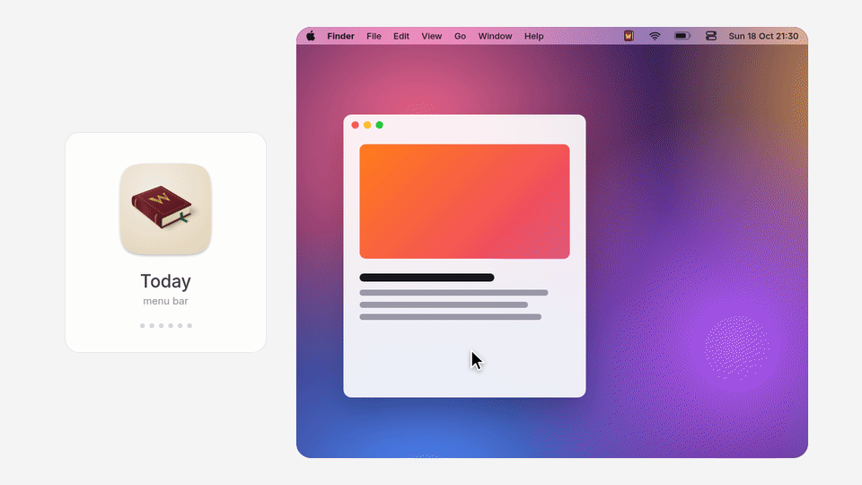
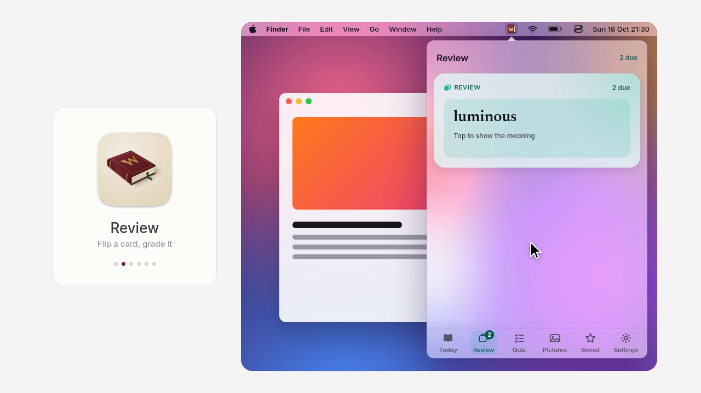
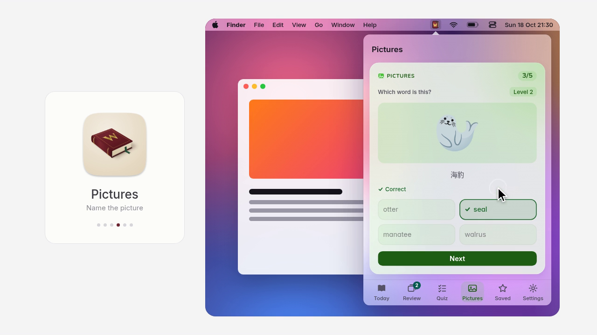
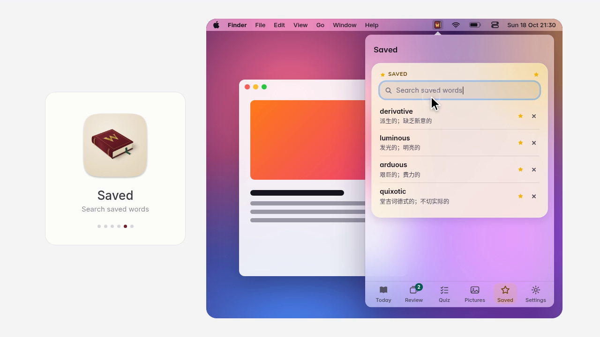
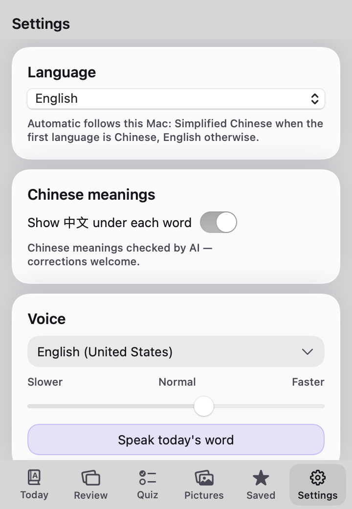
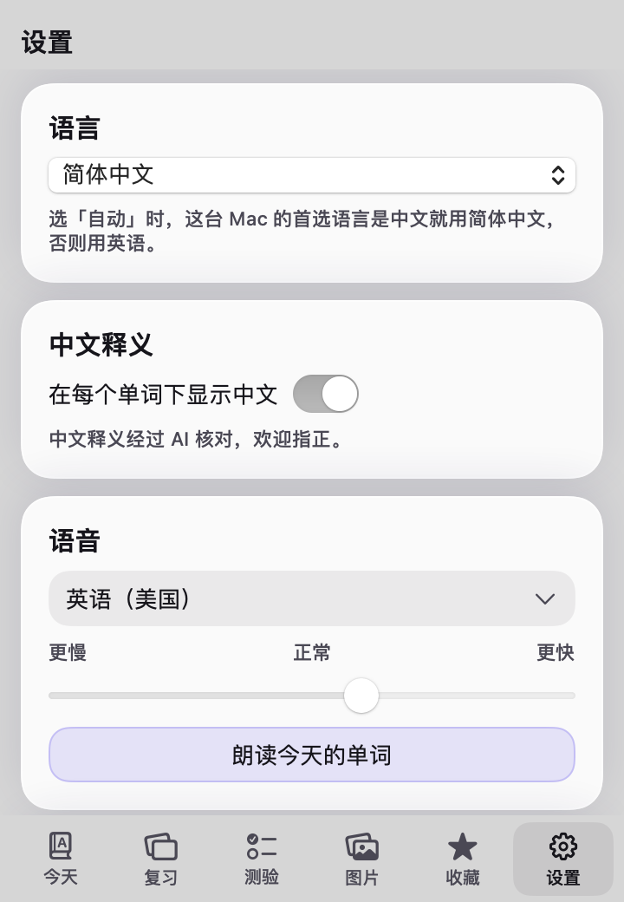
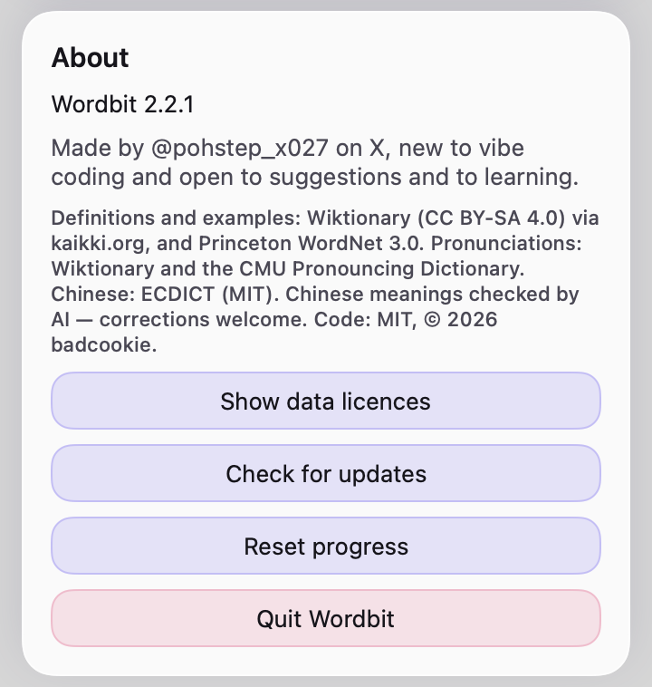

<p align="center">
  
</p>

<h1 align="center">Wordbit</h1>

<p align="center">
  One new English word a day, with its Chinese meaning, in your Mac's menu bar.<br>
  Review it, quiz yourself, play a picture game, and keep a daily streak. No account. The words need no internet.
</p>

<p align="center">
  <a href="#说明"><b>说明</b></a> &nbsp;·&nbsp;
  <a href="#download-and-install"><b>Download</b></a> &nbsp;·&nbsp;
  <a href="#using-it"><b>Using it</b></a> &nbsp;·&nbsp;
  <a href="#build-it-yourself"><b>Build it yourself</b></a> &nbsp;·&nbsp;
  <a href="#support"><b>Support</b></a>
</p>

<p align="center">
  
</p>

## What it does

- **A word for today.** Every day you get one useful English word: how to say it (with a speaker button), what it means, an example sentence, the Chinese meaning, and where the word comes from when we know.
- **Review that comes back at the right time.** Words you've seen go into numbered boxes. **Box 1 means "you'll see it again soon"**, usually tomorrow. Each time you get a word right, it moves up a box and waits longer before it comes back (from a few days up to three months). Get it wrong and it drops back to Box 1. So the words you know get spaced out, and the ones you keep forgetting keep coming back.
- **A daily quiz.** Five quick questions a day: pick the right meaning, or fill the gap in an example sentence.
- **Pictures game.** You see an emoji and pick the right word out of four. There are 156 picture words, and the wrong answers are look-alikes (like *telescope / microscope / periscope / binoculars*), so you have to know the exact word.
- **Saved words.** Tap the star on any word to keep it in your Saved list. Saved words also go into review.
- **A daily streak.** A day counts when you **finish the quiz or finish the reviews that are due**. There are no "streak freezes": miss a day and the streak starts again at 1.
- **The meanings are in Chinese today.** The word itself stays English. You can show that Chinese meaning under each word, or hide it with one click. Chinese meanings checked by AI — corrections welcome. Hiding the meaning is separate from the interface language.
- **English or 简体中文.** Menus, tabs, settings, hints and notifications follow the Mac: Simplified Chinese when this Mac's first language is Chinese, English otherwise. **Settings → Language** can be **Automatic (follow Mac)**, **English**, or **简体中文**. It switches straight away.
- **Works offline.** Every word is inside the app. The only network use is **Check for updates** in Settings, and only when you click it.

Wordbit is a small native Mac app written in Swift. There is no account, no ads and no tracking.

<p align="center">
  
</p>

<p align="center">
  <a href="docs/demo-tabs.mp4">Watch the full video (MP4)</a>
</p>

## 说明

Wordbit 是 Mac 菜单栏里的每日英语单词。单词仍是英语，释义目前是中文。

界面默认跟随这台 Mac：首选语言是中文时用简体中文，否则用英语。在「设置 → 语言」里可以改成「自动（跟随 Mac）」、English 或「简体中文」，马上生效，不用重新打开。

「关于」里显示 **Wordbit** 和版本号。只有点「检查更新」才会联网，对照 GitHub 上的最新版本：没有更新会说已是最新，有更新会打开发布页，并提示 `brew upgrade --cask wordbit`。不会自动下载，也不会在后台检查。离线时只提示稍后再试。「重置进度」会先询问，再删除这台 Mac 上的 `state.json`。登录时打开默认是关的。

## Download and install

1. Download `Wordbit-2.2.1.dmg` from the [latest release](https://github.com/pohstep/wordbit/releases/latest).
   - **Or, with Homebrew:** `brew install --cask pohstep/tap/wordbit`. That puts **Wordbit** in Applications, so skip step 2 and go to step 3.
2. Open the `.dmg` file and drag **Wordbit** onto the **Applications** folder next to it.
3. Open **Wordbit** from Applications. The first time, macOS stops it and says *"Apple could not verify…"*. That is because the app is free and not signed with a paid Apple developer account ([why](#why-does-macos-warn-me)). Let it through once:
   - **macOS 15 Sequoia or newer:** click **Done**. Open **System Settings → Privacy & Security**, scroll down to *"Wordbit was blocked…"*, click **Open Anyway**, and type your Mac password.
   - **macOS 13 Ventura or 14 Sonoma:** in the Applications folder, right-click (or Control-click) **Wordbit**, choose **Open**, then click **Open** again.
   - **Or, in Terminal:** `xattr -dr com.apple.quarantine "/Applications/Wordbit.app"`
4. Look for the little book in your menu bar, near the clock. There is no Dock icon and no window. Click the book.

The download is one app for Intel and Apple-chip Macs.

Wordbit does not open itself when you log in. To have it start with your Mac, turn on **Open Wordbit when you log in** in **Settings**. It then appears under **System Settings → General → Login Items**, where you can turn it off too.

What's new in each version: [CHANGELOG.md](CHANGELOG.md).

### Homebrew

```bash
brew install --cask pohstep/tap/wordbit
```

Or tap first, then install:

```bash
brew tap pohstep/tap
brew install --cask wordbit
```

To update later: `brew upgrade --cask wordbit`. The cask is unsigned, same as the disk image. The first open is the **Open Anyway** step above (right-click **Open** only on macOS 13–14).

### Why does macOS warn me?

Apple charges $99 a year for a developer account that "signs" apps so macOS trusts them without asking. Wordbit is free, so it skips that. The code is all here for anyone to read, and you can [build it yourself](#build-it-yourself) instead of downloading.

### Remove it

Open Wordbit's **Settings** tab and click **Quit Wordbit**. Drag **Wordbit** from Applications to the Trash. To also delete your progress, delete the folder `~/Library/Application Support/Wordbit/`.

## Requirements

| | |
| --- | --- |
| Mac | macOS 13 Ventura or newer. Intel and Apple chip |
| Internet | Not needed for the words. **Check for updates** is optional, and only when you click it |
| Only to build it yourself | Apple's Command Line Tools (`xcode-select --install`). The full Xcode app is not needed |

## Using it

Click the book in the menu bar. The panel has six tabs along the bottom.

| Do this | To get this |
| --- | --- |
| **Today** tab | Today's word, how to say it, its meaning, an example, the Chinese, and its origin. Your streak and this week are underneath |
| Click the speaker | Hear the word, or the example sentence, read aloud |
| Click the star | Save the word to your Saved list (and into review) |
| Click the **中文** pill | Show or hide the Chinese meaning |
| **Review** tab | Flashcards for the words that are due. Click to flip, then **Again** (back to Box 1), **Good** (up one box) or **Easy** (up two boxes) |
| **Quiz** tab | Today's five questions. Finishing it counts for your streak, whatever your score |
| **Pictures** tab | The emoji word game. **Play again** for a new round. Just for fun; it doesn't change your streak |
| **Saved** tab | Your starred words. Search them, open one, or remove it |
| **Settings** tab | **Language**, Chinese meanings on or off, the voice and how fast it talks, a daily reminder at a time you pick (off until you turn it on; the time is this Mac's clock), open at login (off until you turn it on), data licences, and **Quit** |
| **Settings → Language** and **About** | **Automatic (follow Mac)**, **English**, or **简体中文** (it changes straight away). About shows **Wordbit** and the version, **Check for updates**, and **Reset progress** |

How the review boxes work:

| Box | Comes back after |
| --- | --- |
| 1 | 1 day |
| 2 | 3 days |
| 3 | 1 week |
| 4 | 2 weeks |
| 5 | 1 month |
| 6 | 3 months |

Today's word, and any word you star, joins Box 1 and comes back the next day.

On the first day, Review has nothing due yet and Saved is empty. Both say **Nothing yet** and link to the **Quiz** and **Pictures** tabs.

**About the date:** Wordbit always uses your Mac's local time, so the new word arrives at your local midnight and the streak follows your day. People in different time zones can be on different dates, so the word for "today" can differ. The word for a given calendar date is always the same: 18 October 2026 is **derivative**. Saved dates and the streak are stored as plain dates, like `2026-10-18`.

### Today

<p align="center">
  
</p>

### Review

<p align="center">
  
</p>

### Quiz

<p align="center">
  
</p>

### Pictures

<p align="center">
  
</p>

### Saved

<p align="center">
  
</p>

### Settings

<p align="center">
  
  
</p>

Settings in English and in 简体中文. Changing **Language** switches the whole panel straight away.

<p align="center">
  
</p>

**About**, at the bottom of Settings, shows the version and has **Check for updates**, **Reset progress** and **Quit Wordbit**.

**Language** is **Automatic (follow Mac)**, **English**, or **简体中文**. Automatic uses Simplified Chinese when this Mac's first language is Chinese, and English otherwise. Changing it updates the panel immediately. The words stay English, and the meanings are in Chinese today.

**Daily reminder** is off until you turn it on. The time uses the clock on this Mac. If a reminder never arrives, allow Wordbit in **System Settings → Notifications**.

**About** shows **Wordbit** and the version shipped in the app. **Check for updates** runs only when you click it. **Open at login** stays off until you turn it on. **Reset progress** asks before it deletes your saved state.

## Privacy

Wordbit does not phone home. There's no account, no analytics and no tracking. Speech uses the voices already on your Mac, and the reminder (if you turn it on) is a notification made by your Mac itself.

**Check for updates** is the one exception, and it runs only when you click the button. It asks GitHub for the latest release of this app (`api.github.com`). It sends no words, streak or settings. If you are offline, or GitHub has nothing to compare, it says so and stops. It does not download an update, and it does not check in the background.

Everything about you is in one file on your Mac:

| File | What's in it |
| --- | --- |
| `~/Library/Application Support/Wordbit/state.json` | Which words you've seen and when, your Saved words, your review boxes and due dates, your streak (current, best, last day), your quiz scores by date, and your settings (Chinese on/off, voice, speed, reminder, reminder time, interface language) |

That's all. Nothing is sent anywhere. Quit Wordbit before you edit that file, or delete it to start over from scratch. It is not part of this repository or the `.dmg`.

## Word data credits and licences

The Wordbit code is MIT licensed (see [LICENSE](LICENSE)). The word lists come from open sources that keep their own licences. The full texts are in [DATA-LICENSES.md](DATA-LICENSES.md), which also ships inside the app (**Settings → Show data licences**).

| What | From | Licence |
| --- | --- | --- |
| Definitions, examples, word origins, some pronunciations | [Wiktionary](https://en.wiktionary.org/), via [kaikki.org](https://kaikki.org/) ([Wiktextract](https://github.com/tatuylonen/wiktextract)) | [CC BY-SA 4.0](https://creativecommons.org/licenses/by-sa/4.0/) |
| Some definitions and examples | [Princeton WordNet 3.0](https://wordnet.princeton.edu/) | WordNet 3.0 licence (free to use, keep the notice) |
| Other pronunciations | [CMU Pronouncing Dictionary](https://github.com/cmusphinx/cmudict) | BSD-style |
| Chinese meanings | [ECDICT](https://github.com/skywind3000/ECDICT) by Linwei, shortened. Chinese meanings checked by AI — corrections welcome | MIT |
| Picture-game pictures | Apple Color Emoji, drawn by your Mac when the app runs. No emoji images are included in this repository or the app | Part of macOS |
| Promo images and video in this README | Promo images rendered with Noto Emoji, Apache 2.0. The screenshots and video are illustrative: the app itself shows Apple Color Emoji | [Apache 2.0](https://github.com/googlefonts/noto-emoji) |
| The "W" on the app icon | Drawn from the [Cinzel](https://github.com/NDISCOVER/Cinzel) typeface by Natanael Gama | [SIL Open Font License 1.1](https://openfontlicense.org) |

Because some word fields are CC BY-SA 4.0, if you reuse `Resources/words.json`, keep the credit and share those fields under the same licence.

Spotted a wrong meaning or a bad Chinese translation? Please [open an issue](https://github.com/pohstep/wordbit/issues).

## Build it yourself

You can build the app from the code instead of downloading the `.dmg`. On your Mac, in Terminal:

```bash
git clone https://github.com/pohstep/wordbit.git
cd wordbit
./install.sh
```

That builds Wordbit for Intel and Apple chip, runs a quick self-check, puts it in `~/Applications`, and opens it. If macOS asks you to install the Command Line Tools, click **Install**, wait for it to finish, and run `./install.sh` again.

The first time, macOS may stop the app. The script prints the same steps as [Download and install](#download-and-install):

- **macOS 15 Sequoia or newer:** click **Done**. Open **System Settings → Privacy & Security**, scroll down to *"Wordbit was blocked…"*, click **Open Anyway**, and type your Mac password.
- **macOS 13 Ventura or 14 Sonoma:** in `~/Applications`, right-click (or Control-click) **Wordbit**, choose **Open**, then click **Open** again.
- **Or, in Terminal:** `xattr -dr com.apple.quarantine "$HOME/Applications/Wordbit.app"`

If `~/Applications/Word of the Day.app` is there, the script says so and removes it. Wordbit replaces that older app.

## Development notes

```
Sources/     the app (Swift, AppKit + SwiftUI). No Xcode project; install.sh is the build.
             L10nEn.swift and L10nZhHans.swift are the interface languages, one file each
Resources/   words.json (400 study words), pictures.json (156 picture words), icons, Info.plist
scripts/     Python scripts that build the word and picture lists, plus make-dmg.sh
data/        the version 1 word list and the build report
docs/        README images
packaging/   Homebrew cask (packaging/homebrew/Casks/wordbit.rb)
```

| Command | What it does |
| --- | --- |
| `./install.sh` | Build for both chip types, check, install to `~/Applications/Wordbit.app`, and open it |
| `./install.sh --build-only` | Build into `build/Wordbit.app` and run the check, without installing |
| `./scripts/make-dmg.sh` | Run the universal build, then write `build/Wordbit-2.2.1.dmg` and print its SHA-256 |
| `build/Wordbit.app/Contents/MacOS/Wordbit --check` | The self-check: word count, a known date's word in the Mac's time zone, quiz shape, and that every picture emoji exists |
| `lipo -info build/Wordbit.app/Contents/MacOS/Wordbit` | Confirms the app holds both arm64 and x86_64 |
| `python3 scripts/build_resources.py /path/to/ecdict.csv` | Refresh the Chinese meanings from an ECDICT download |
| `python3 scripts/build_pictures.py` | Rebuild the picture word list |
| `python3 scripts/apply_cn_fixes.py` | Re-apply the hand corrections in `scripts/cn_fixes.json` (the build scripts do this for you) |

- The word for a calendar date is the number of days since 1 January 2026 in the Mac's own time zone, counted around the 400-word list. The word for that date is unchanged from version 2.0: 1 January 2026 is **dormant** and 18 October 2026 is **derivative**.
- `scripts/build_words.py` is the original version 1 generator. It needs a kaikki.org download and NLTK data, which are not in this repository.
- A new install starts fresh: only today's word goes into review on the first day.
- `install.sh` compiles with `-target arm64-apple-macos13` and `-target x86_64-apple-macos13`, joins the two with `lipo -create`, and signs "ad hoc" (no Apple developer account). `scripts/make-dmg.sh` puts that app in a disk image with a shortcut to Applications, made with `hdiutil`.
- The app ID is `com.pohstep.wordbit`.
- Interface strings live in `Sources/L10nEn.swift` (English, the source language) and `Sources/L10nZhHans.swift` (Simplified Chinese). A new interface language is another file that covers every `L10nKey`, plus a line in `InterfaceLanguage`. The English words and their Chinese meanings are not in those files. The meanings are in Chinese today.
- The recipe at `packaging/homebrew/Casks/wordbit.rb` is version 2.2.1. Its SHA-256 matches `Wordbit-2.2.1.dmg` on the GitHub release.
- Launch flags are `--check`, `--show` and `--make-iconset`. There is no screenshot render mode.

## Changelog

See [CHANGELOG.md](CHANGELOG.md).

## Support

Wordbit is free and open source. If it saves you time, a dollar is appreciated, never expected.

| Chain | Address |
| --- | --- |
| Ethereum | `0x13073220a7f565a6690466e4c73Cdf960b89767E` |
| Polygon | `0x13073220a7f565a6690466e4c73Cdf960b89767E` |
| Bitcoin | `bc1qp33c2ltr9l56gr0qhkydwhrs659ex87l8xhu5t` |

Send only on the matching network.

A star, a bug report or a word correction helps just as much.

## About

Made by badcookie ([@pohstep_x027](https://x.com/pohstep_x027) on X), built with AI bots. I'm new to vibe coding and building this in public, so suggestions, issues and pull requests are very welcome. I'm here to learn.

## License

The code is [MIT](LICENSE). The word data keeps its own licences; see [Word data credits and licences](#word-data-credits-and-licences).
