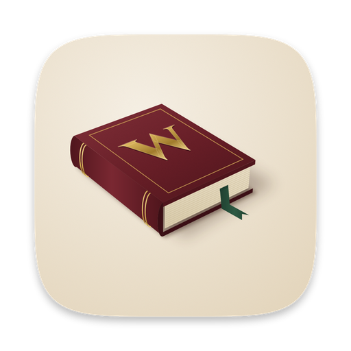
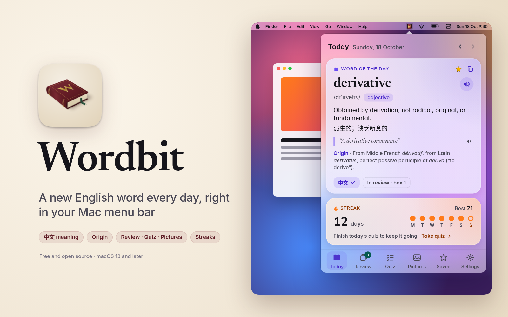
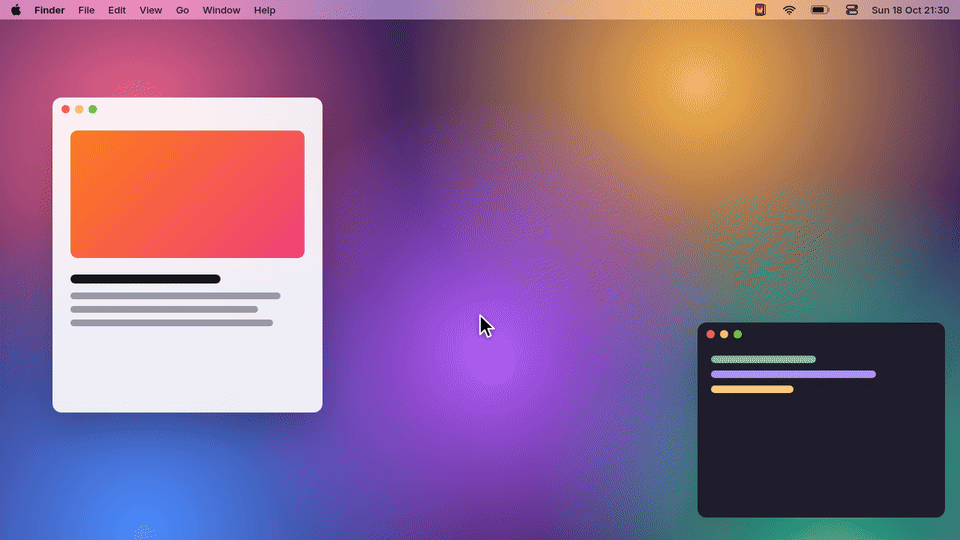

<p align="center">
  
</p>

<h1 align="center">Wordbit</h1>

<p align="center">
  One new English word a day, with its Chinese meaning, in your Mac's menu bar.<br>
  Review it, quiz yourself, play a picture game, and keep a daily streak. No account, no internet needed.
</p>

<p align="center">
  <a href="#download-and-install"><b>Download</b></a> &nbsp;·&nbsp;
  <a href="#build-it-yourself"><b>Build it yourself</b></a> &nbsp;·&nbsp;
  <a href="#support"><b>Support</b></a>
</p>

<p align="center">
  
</p>

## What it does

- **A word for today.** Every day you get one useful English word: how to say it (with a speaker button), what it means, an example sentence, the Chinese meaning, and where the word comes from when we know.
- **Review that comes back at the right time.** Words you've seen go into numbered boxes. **Box 1 means "you'll see it again soon"**, usually tomorrow. Each time you get a word right, it moves up a box and waits longer before it comes back (from a few days up to three months). Get it wrong and it drops back to Box 1. So the words you know get spaced out, and the ones you keep forgetting keep coming back.
- **A daily quiz.** Five quick questions a day: pick the right meaning, or fill the gap in an example sentence.
- **Pictures game.** You see an emoji and pick the right word out of four. There are 156 picture words, and the wrong answers are look-alikes (like *telescope / microscope / periscope / binoculars*), so you have to know the exact word.
- **Saved words.** Tap the star on any word to keep it in your Saved list. Saved words also go into review.
- **A daily streak.** A day counts when you **finish the quiz or finish the reviews that are due**. There are no "streak freezes": miss a day and the streak starts again at 1.
- **Chinese on or off.** Show the Chinese meaning under each word, or hide it with one click. Chinese meanings checked by AI — corrections welcome.
- **Works fully offline.** Every word is inside the app. It never connects to the internet.

Wordbit is a small native Mac app written in Swift. There is no account, no ads and no tracking.

<p align="center">
  
</p>

## Download and install

1. Download `Wordbit-2.0.0.dmg` from the [latest release](https://github.com/pohstep/wordbit/releases/latest).
2. Open the `.dmg` file and drag **Wordbit** onto the **Applications** folder next to it.
3. Open **Wordbit** from Applications. The first time, macOS stops it and says *"Apple could not verify…"*. That is because the app is free and not signed with a paid Apple developer account ([why](#why-does-macos-warn-me)). Let it through once:
   - **macOS 15 Sequoia or newer:** click **Done**. Open **System Settings → Privacy & Security**, scroll down to *"Wordbit was blocked…"*, click **Open Anyway**, and type your Mac password.
   - **macOS 13 Ventura or 14 Sonoma:** in the Applications folder, right-click (or Control-click) **Wordbit**, choose **Open**, then click **Open** again.
   - **Or, in Terminal:** `xattr -dr com.apple.quarantine "/Applications/Wordbit.app"`
4. Look for the little book in your menu bar, near the clock. There is no Dock icon and no window. Click the book.

On a Mac with an Apple chip (M1 or newer), macOS may first ask to install **Rosetta**. Click **Install**. This build of the app is made for Intel Macs, and Rosetta lets it run on Apple chips. (If you [build it yourself](#build-it-yourself) on an Apple-chip Mac, you get a native version and don't need Rosetta.)

Wordbit adds itself to **System Settings → General → Login Items** the first time it runs, so it opens when you turn on your Mac. You can switch that off in Wordbit's **Settings** tab.

What's new in each version: [CHANGELOG.md](CHANGELOG.md).

### Why does macOS warn me?

Apple charges $99 a year for a developer account that "signs" apps so macOS trusts them without asking. Wordbit is free, so it skips that. The code is all here for anyone to read, and you can [build it yourself](#build-it-yourself) instead of downloading.

### Remove it

Open Wordbit's **Settings** tab and click **Quit Wordbit**. Drag **Wordbit** from Applications to the Trash. To also delete your progress, delete the folder `~/Library/Application Support/Wordbit/`.

## Requirements

| | |
| --- | --- |
| Mac | macOS 13 Ventura or newer. Intel, or Apple chip with Rosetta |
| Internet | Not needed |
| Only to build it yourself | Apple's Command Line Tools (`xcode-select --install`). The full Xcode app is not needed |

## Using it

Click the book in the menu bar. The panel has six tabs along the bottom.

| Do this | To get this |
| --- | --- |
| **Today** tab | Today's word, how to say it, its meaning, an example, the Chinese, and its origin. Your streak and this week are underneath |
| Click the speaker | Hear the word, or the example sentence, read aloud |
| Click the star | Save the word to your Saved list (and into review) |
| Click the **中文** pill | Show or hide the Chinese meaning |
| **Review** tab | Flashcards for the words that are due. Click to flip, then **Again** (back to Box 1), **Good** (up one box) or **Easy** (up two boxes) |
| **Quiz** tab | Today's five questions. Finishing it counts for your streak, whatever your score |
| **Pictures** tab | The emoji word game. **Play again** for a new round. Just for fun; it doesn't change your streak |
| **Saved** tab | Your starred words. Search them, open one, or remove it |
| **Settings** tab | Chinese on or off, the voice and how fast it talks, a daily reminder at 8:00 (off until you turn it on), open at login, data licences, and **Quit** |

How the review boxes work:

| Box | Comes back after |
| --- | --- |
| 1 | 1 day |
| 2 | 3 days |
| 3 | 1 week |
| 4 | 2 weeks |
| 5 | 1 month |
| 6 | 3 months |

Today's word, and any word you star, joins Box 1 and comes back the next day.

**About the date:** Wordbit follows the date in China (Asia/Shanghai time), so everyone gets the same word on the same day. If your Mac is set to another time zone, the new word arrives at midnight China time, not your local midnight.

## Privacy

Wordbit never connects to the internet. There's no account, no analytics and no tracking. Speech uses the voices already on your Mac, and the reminder (if you turn it on) is a notification made by your Mac itself.

Everything about you is in one file on your Mac:

| File | What's in it |
| --- | --- |
| `~/Library/Application Support/Wordbit/state.json` | Which words you've seen and when, your Saved words, your review boxes and due dates, your streak (current, best, last day), your quiz scores by date, and your settings (Chinese on/off, voice, speed, reminder) |

That's all. Nothing is sent anywhere. Quit Wordbit before you edit that file, or delete it to start over from scratch. It is not part of this repository or the `.dmg`.

## Word data credits and licences

The Wordbit code is MIT licensed (see [LICENSE](LICENSE)). The word lists come from open sources that keep their own licences. The full texts are in [DATA-LICENSES.md](DATA-LICENSES.md), which also ships inside the app (**Settings → Show data licences**).

| What | From | Licence |
| --- | --- | --- |
| Definitions, examples, word origins, some pronunciations | [Wiktionary](https://en.wiktionary.org/), via [kaikki.org](https://kaikki.org/) ([Wiktextract](https://github.com/tatuylonen/wiktextract)) | [CC BY-SA 4.0](https://creativecommons.org/licenses/by-sa/4.0/) |
| Some definitions and examples | [Princeton WordNet 3.0](https://wordnet.princeton.edu/) | WordNet 3.0 licence (free to use, keep the notice) |
| Other pronunciations | [CMU Pronouncing Dictionary](https://github.com/cmusphinx/cmudict) | BSD-style |
| Chinese meanings | [ECDICT](https://github.com/skywind3000/ECDICT) by Linwei, shortened. Chinese meanings checked by AI — corrections welcome | MIT |
| Picture-game pictures | Apple Color Emoji, drawn by your Mac when the app runs. No emoji images are included in this repository or the app | Part of macOS |
| Promo images in this README | Promo images rendered with Noto Emoji, Apache 2.0. The screenshots are illustrative: the app itself shows Apple Color Emoji | [Apache 2.0](https://github.com/googlefonts/noto-emoji) |
| The "W" on the app icon | Drawn from the [Cinzel](https://github.com/NDISCOVER/Cinzel) typeface by Natanael Gama | [SIL Open Font License 1.1](https://openfontlicense.org) |

Because some word fields are CC BY-SA 4.0, if you reuse `Resources/words.json`, keep the credit and share those fields under the same licence.

Spotted a wrong meaning or a bad Chinese translation? Please [open an issue](https://github.com/pohstep/wordbit/issues).

## Build it yourself

You can build the app from the code instead of downloading the `.dmg`. On your Mac, in Terminal:

```bash
git clone https://github.com/pohstep/wordbit.git
cd wordbit
./install.sh
```

That builds Wordbit with Apple's free Command Line Tools, runs a quick self-check, and puts it in `~/Applications`. Then open it from Finder. If macOS asks you to install the Command Line Tools, click **Install**, wait for it to finish, and run `./install.sh` again.

`./install.sh` also removes the older "Word of the Day" app if it finds it, since Wordbit replaces it.

## Development notes

```
Sources/     the app (Swift, AppKit + SwiftUI). No Xcode project; install.sh is the build
Resources/   words.json (400 study words), pictures.json (156 picture words), icons, Info.plist
scripts/     Python scripts that build the word and picture lists and apply Chinese fixes
data/        the version 1 word list and the build report
docs/        README images
```

| Command | What it does |
| --- | --- |
| `./install.sh` | Build, check and install to `~/Applications/Wordbit.app` |
| `./install.sh --build-only` | Build into `build/Wordbit.app` and run the check, without installing |
| `build/Wordbit.app/Contents/MacOS/Wordbit --check` | The self-check: word count, a known date's word, quiz shape, and that every picture emoji exists |
| `python3 scripts/build_resources.py /path/to/ecdict.csv` | Refresh the Chinese meanings from an ECDICT download |
| `python3 scripts/build_pictures.py` | Rebuild the picture word list |
| `python3 scripts/apply_cn_fixes.py` | Re-apply the hand corrections in `scripts/cn_fixes.json` (the build scripts do this for you) |

- The word for a date is the number of days since 1 January 2026 (China time), counted around the 400-word list. So 1 January 2026 is **dormant** and 18 October 2026 is **derivative**.
- `scripts/build_words.py` is the original version 1 generator. It needs a kaikki.org download and NLTK data, which are not in this repository.
- A new install starts fresh: only today's word goes into review on the first day.
- The app is built as an Intel binary for macOS 13 and signed "ad hoc" (no Apple developer account). The release `.dmg` holds that app plus a shortcut to Applications, made with `hdiutil`.
- The app ID is `com.pohstep.wordbit`.

## Changelog

See [CHANGELOG.md](CHANGELOG.md).

## Support

Wordbit is free and open source. If it saves you time, a dollar is appreciated, never expected.

| Chain | Address |
| --- | --- |
| Ethereum | `0x13073220a7f565a6690466e4c73Cdf960b89767E` |
| Polygon | `0x13073220a7f565a6690466e4c73Cdf960b89767E` |
| Bitcoin | `bc1qp33c2ltr9l56gr0qhkydwhrs659ex87l8xhu5t` |

Send only on the matching network.

A star, a bug report or a word correction helps just as much.

## About

Made by badcookie ([@pohstep_x027](https://x.com/pohstep_x027) on X), built with AI bots. I'm new to vibe coding and building this in public, so suggestions, issues and pull requests are very welcome. I'm here to learn.

## License

The code is [MIT](LICENSE). The word data keeps its own licences; see [Word data credits and licences](#word-data-credits-and-licences).
